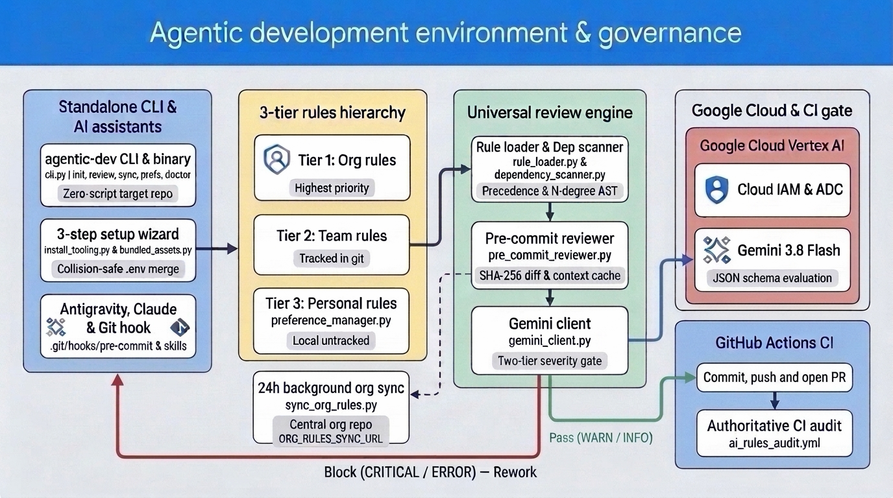
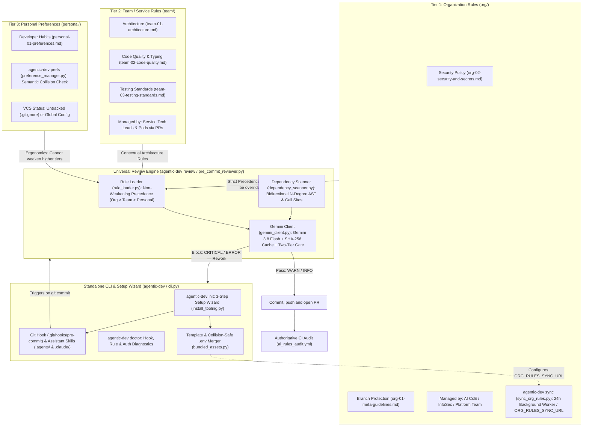
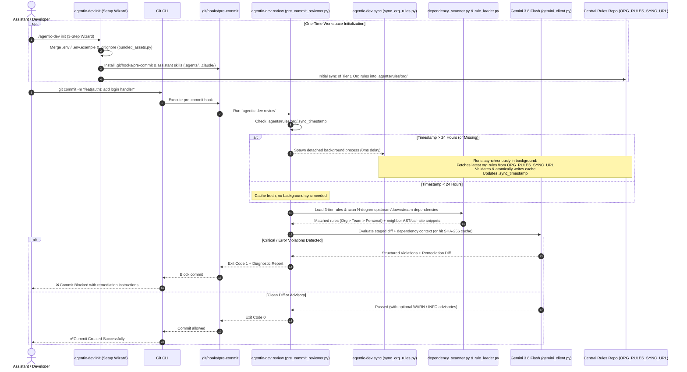

# Agentic Development Environment

[](https://www.python.org/)
[](https://deepmind.google/technologies/gemini/)
[](AGENTS.md)
[](LICENSE)

A vendor-neutral, portable **Agentic Development Environment** designed for seamless pair programming and governed collaboration between human developers and AI coding assistants (Google Antigravity, Anthropic Claude Code, Cursor, and IDE tooling).

This repository provides:
1. **Multi-Tier Rules Governance Hierarchy** (`.agents/rules/org/`, `.agents/rules/team/`, `.agents/rules/personal/`): Distinct rule lifecycles separating enterprise guardrails, service architecture standards, and personal developer preferences.
2. **24-Hour Non-Blocking Background Org Rule Sync** (`scripts/sync_org_rules.py`): Automatically checks and updates enterprise rules in a detached background worker without delaying developers' pre-commit workflows.
3. **Dynamic Multi-Assistant Tooling & Skills** (`scripts/install_tooling.py`): Zero repository clutter; generates Git hooks, Antigravity skills/hooks, and Claude Code commands on demand.
4. **VCS-Isolated Personal Preference Persistence** (`scripts/preference_manager.py` & `.agents/rules/personal/`): Captures developer habits into persistent rules without polluting git diffs or creating repository merge conflicts.
5. **Universal Pre-Commit Review Engine & Multi-Language Dependency Scanner** (`scripts/pre_commit_reviewer.py`, `scripts/dependency_scanner.py`, & `scripts/gemini_client.py`): Gemini 3.8 Flash powered diff evaluation with bidirectional N-degree local dependency context scanning (upstream contracts & downstream callers across Python, Java, Go, TypeScript/JS, Rust, Kotlin, C#, and C/C++), Google Application Default Credentials (ADC) and Google AI Studio support, SHA-256 diff + dependency caching, and a non-weakening multi-tier gating policy.
6. **Authoritative CI Gatekeeper** (`.github/workflows/ai_rules_audit.yml`): "Two-Grip" governance model providing local pre-commit assistance paired with mandatory remote CI compliance.
7. **Standalone Binary & Unified CLI (`agentic-dev`)** (`scripts/cli.py`, `scripts/build_binary.py`, & `scripts/package_tooling.py`): Zero-clutter native binary (`dist/agentic-dev`) and lightweight zipapp (`dist/agentic-dev.pyz`) with an interactive 3-step setup wizard, collision-safe `.env` management, and dynamic organizational rule synchronization.

---

## Architecture & Governance Workflow



### 1. Multi-Tier Governance & CLI Flow Architecture

Rules are partitioned into three distinct lifecycles and orchestrated through the unified `agentic-dev` CLI (`scripts/cli.py`) to prevent cross-contamination, rule drift, and VCS merge conflicts:



### 2. The 24-Hour Non-Blocking Org Rule Sync & Review Cycle



### 3. Bidirectional N-Degree Local Dependency Context (`scripts/dependency_scanner.py`)

Rather than evaluating staged diffs in isolation, `pre_commit_reviewer.py` automatically traverses **N degrees of local code dependencies** (default `1` degree) around modified diff hunks:

- **Upstream Definitions & Contracts**: Resolves local modules, packages, classes, interfaces, structs, and functions imported and referenced by the modified code so the reviewer can detect contract mismatches or architectural layer violations.
- **Downstream Callers & Importers**: Discovers production call sites across the repository that import or invoke symbols modified in the staged diff (automatically excluding unit/integration test files) so breaking signature or behavioral changes are caught before commit.
- **Multi-Language Support (Zero External Dependencies)**:
  - **Python** (`.py`): Full `ast` symbol definition, import alias, and enclosing call-site resolution.
  - **Java & Kotlin** (`.java`, `.kt`, `.kts`): Cross-package `import` / `import static` / wildcard resolution plus automatic same-package sibling class resolution.
  - **Go** (`.go`): Single-line and block `import (...)` package directory resolution plus same-package sibling `.go` file resolution.
  - **TypeScript & JavaScript** (`.ts`, `.tsx`, `.js`, `.jsx`, `.mjs`, `.cjs`): Single- and multi-line `import`/`export`, `require()`, relative specifiers (`./`, `../`), and path aliases (`@/`, `~/`, `src/`).
  - **Rust, C#, & C/C++** (`.rs`, `.cs`, `.c`, `.cpp`, `.cc`, `.h`, `.hpp`): `use crate::...`, `mod ...;`, and `#include "..."` header/implementation resolution.
- **Git Index vs. `HEAD` Isolation**: Reads staged files from the Git index (`:path`) and untouched neighbor files from `HEAD` (`HEAD:path`), flagging any impacted neighbor file that has unstaged working-tree edits.
- **Relational Impact Enforcement**: Neighbor snippets are used strictly to verify relational compatibility with the staged diff—pre-existing unrelated style issues in untouched neighbor files never block a commit.

---

## Rule Tiers & Precedence Rules

| Tier | Directory | Owner & Lifecycle | Version Control (VCS) | Precedence |
| :--- | :--- | :--- | :--- | :--- |
| **Tier 1: Organization** | [`.agents/rules/org/`](.agents/rules/org/) | AI CoE / InfoSec / Platform Engineering | Read-only mirror in project repo. | **Highest ($\text{Org} \succ \text{Team} \succ \text{Personal}$)** |
| **Tier 2: Team** | [`.agents/rules/team/`](.agents/rules/team/) | Service Pods & Domain Tech Leads | Committed and tracked via PRs. | **Middle** |
| **Tier 3: Personal** | [`.agents/rules/personal/`](.agents/rules/personal/) | Individual Developer | Committed template example ([`personal-01-preferences.md`](.agents/rules/personal/personal-01-preferences.md)) / untracked local rules (`.gitignore`). | **Lowest** |

### The Non-Weakening Rule of Precedence
Lower tiers can specialize or add constraints, but **cannot weaken or silence** constraints defined in a higher tier. For example, a personal preference or team rule cannot downgrade an organizational `CRITICAL` or `ERROR` rule to `WARN` or `INFO`.

### Team-Level Rules (Tier 2) Governance & Lifecycle
- **In-Repo Ownership**: Unlike centrally-synced Org rules, Team rules live directly in version control inside `.agents/rules/team/` within each service repository.
- **Service Pod Autonomy**: Domain tech leads customize rules to match the repository's stack, domain boundaries, and patterns (e.g. database conventions, messaging patterns).
- **PR Review & Enforcement Gate**: Any modifications to `.agents/rules/team/` require a Pull Request and must pass automated CI checks (`.github/workflows/ai_rules_audit.yml`) to guarantee they cannot weaken or override Tier 1 Org constraints.

---

## Setting Up a Central Organizational Rules Repository

Organizations maintain canonical Tier 1 rules in a dedicated central governance repository (managed by InfoSec, Platform Engineering, or an AI CoE). Downstream developer repositories pull and mirror these rules automatically.

> [!TIP]
> **Reference Implementation**: Inspect the reference governance repository at [buildwithdc/sample-agentic-dev-governance-rules](https://github.com/buildwithdc/sample-agentic-dev-governance-rules).

### Quick-Start Guide for AI CoE & Platform Teams

1. **Create the Central Governance Repository**:
   ```bash
   gh repo create sample-agentic-dev-governance-rules --public --clone
   cd sample-agentic-dev-governance-rules
   ```

2. **Structure the Canonical Rules**:
   ```bash
   mkdir -p org
   # Place enterprise canonical rules in org/:
   # org/org-01-meta-guidelines.md
   # org/org-02-security-and-secrets.md
   ```

3. **Package & Publish Release Bundle**:
   Create a zip asset containing the canonical rules and attach it to a GitHub release:
   ```bash
   zip -j rules-org.zip org/*.md
   gh release create v1.0.0 rules-org.zip --title "v1.0.0 Canonical Rules" --notes "Baseline governance rules"
   ```

4. **Subscribe Downstream Repositories**:
   In downstream service repositories, set `ORG_RULES_SYNC_URL` in `.env`:
   ```env
   ORG_RULES_SYNC_URL="https://github.com/buildwithdc/sample-agentic-dev-governance-rules/releases/latest/download/rules-org.zip"
   ```
   Downstream projects automatically keep their `.agents/rules/org/` cache updated during git pre-commit checks without blocking developers.


---

## Directory Structure

```text
.
├── .agents/
│   ├── rules/                         # Canonical markdown best-practice rules
│   │   ├── README.md                  # Multi-tier rule catalog & taxonomy
│   │   ├── org/                       # Tier 1: Organization-wide enterprise rules
│   │   │   ├── org-01-meta-guidelines.md # Branch protection, PR standards, conventional commits
│   │   │   ├── org-02-security-and-secrets.md # Secret sanitization, zero hardcoded credentials
│   │   │   └── .sync_timestamp        # Local TTL timestamp (untracked)
│   │   ├── team/                      # Tier 2: Team / domain architecture rules
│   │   │   ├── team-01-architecture.md # Layer isolation, domain boundaries, typed contracts
│   │   │   ├── team-02-code-quality.md # Strict typing, visible mock warnings, error handling
│   │   │   └── team-03-testing-standards.md # Test suite isolation, deterministic offline stubs
│   │   └── personal/                  # Tier 3: Developer workflow preferences (untracked)
│   │       ├── .gitkeep               # Preserves directory in git
│   │       └── personal-01-preferences.md # Individual workflow preferences
│   ├── skills/                        # Dynamic Antigravity on-demand skills (generated)
│   │   ├── code-auditor/SKILL.md      # On-demand pre-commit diff audit skill
│   │   └── personal-preferences/SKILL.md # Workflow preference capture & rule persistence skill
│   ├── hooks.json                     # Dynamic Antigravity lifecycle hook config (generated)
│   └── audit.log                      # Local audit and sync execution history
├── .claude/
│   ├── commands/                      # Dynamic Claude Code slash commands (generated)
│   │   ├── audit.md                   # /audit command
│   │   └── preferences.md             # /preferences command
│   └── skills/                        # Dynamic Claude Code on-demand skills (generated)
│       ├── code-auditor/SKILL.md      # On-demand pre-commit diff audit skill
│       └── personal-preferences/SKILL.md # Workflow preference capture & rule persistence skill
├── .github/
│   └── workflows/
│       └── ai_rules_audit.yml         # Authoritative CI server-side compliance gate
├── assets/
│   └── architecture_diagram.png       # High-definition system architecture & governance diagram
├── dist/
│   ├── agentic-dev                    # Standalone native CLI binary (PyInstaller --onefile)
│   ├── agentic-dev.pyz                # Lightweight stdlib zipapp executable
│   └── dev-env-tooling.zip            # Legacy portable script distribution bundle
├── scripts/
│   ├── __init__.py                    # Package metadata & version
│   ├── build_binary.py                # Reproducible builder for dist/agentic-dev and dist/agentic-dev.pyz
│   ├── bundled_assets.py              # Workspace template bootstrapper & collision-safe .env merger
│   ├── cli.py                         # Unified agentic-dev CLI dispatcher (init, review, sync, prefs, doctor)
│   ├── constants.py                   # Centralized repository constants for rule paths & tiers
│   ├── dependency_scanner.py          # Bidirectional N-degree multi-language dependency scanner
│   ├── gemini_client.py               # Gemini 3.8 Flash review client (Vertex AI & Google AI Studio)
│   ├── install_tooling.py             # Dynamic assistant tooling, hook generator, & interactive setup wizard
│   ├── package_tooling.py             # Portable workspace bundler & extractor
│   ├── pre_commit_reviewer.py         # Universal pre-commit review CLI & gating engine
│   ├── preference_manager.py          # Preference inspector, updater, and rule formatter
│   ├── rule_loader.py                 # Multi-tier rule loader & precedence resolver
│   └── sync_org_rules.py              # 24-hour background organizational rule synchronizer
├── tests/
│   ├── unit/                          # Isolated unit tests for installer, loader, packager, reviewer, sync
│   └── integration/                   # End-to-end Git hook lifecycle integration tests
├── .env.example                       # Environment configuration template
├── AGENTS.md                          # Human-Agent collaboration protocol & branch guidelines
├── pyproject.toml                     # Project dependencies and lint configuration
└── README.md                          # Project documentation
```

---

## Quick Start Guide

### 1. Setting Up in This Repository

1. **Configure Google Cloud / Gemini Credentials**:
   - **Option A (Recommended: Google Cloud ADC)**:
     ```bash
     gcloud auth application-default login
     ```
   - **Option B (Google AI Studio API Key)**:
     ```bash
     cp .env.example .env
     # Edit .env and set GEMINI_API_KEY=your_key_here
     ```

2. **Install Assistant Tooling & Git Hooks**:
   ```bash
   python3 scripts/install_tooling.py --all
   ```
   This generates the native `.git/hooks/pre-commit`, Antigravity skills & hooks (`.agents/`), and Claude Code commands & skills (`.claude/`).

3. **Stage Changes & Commit**:
   ```bash
   git add .
   git commit -m "feat(core): implement feature"
   ```
   The pre-commit hook automatically checks organizational rule freshness, loads rules across all tiers, and reviews staged diffs using Gemini 3.8 Flash.

---

### 2. Distributing into Another Repository

You can distribute and bootstrap this tooling environment into any target repository using either the **standalone `agentic-dev` binary** (zero `scripts/*.py` copied into the target repository) or the portable script bundle:

#### Option A (Recommended): Standalone Binary (`agentic-dev`)

1. **Build the Standalone Binary**:
   ```bash
   # Build both dist/agentic-dev (native binary) and dist/agentic-dev.pyz (zipapp)
   .venv/bin/python scripts/build_binary.py

   # Optional: also install to ~/.local/bin/agentic-dev
   .venv/bin/python scripts/build_binary.py --install-local
   ```

2. **Initialize Any Target Repository (Interactive 3-Step Wizard)**:
   Place `agentic-dev` on your `PATH` (or directly in the target project root `./agentic-dev`) and run `init`:
   ```bash
   cd /path/to/target-workspace
   ./agentic-dev init
   ```
   The interactive wizard guides you through:
   - **Step 1**: Selecting your coding assistant(s) (Antigravity, Claude Code, `AGENTS.md` pointer, or Git hook only).
   - **Step 2**: Creating or non-destructively merging `.env` & `.env.example` using `# BEGIN AGENTIC DEV ENV` ... `# END AGENTIC DEV ENV` blocks (preserving any existing variables in your `.env`) and configuring `ORG_RULES_SYNC_URL`.
   - **Step 3**: Configuring `.gitignore` for generated assistant configs and local state (without adding `scripts/*.py` when running from the binary).

3. **Verify Setup & Run Commands**:
   ```bash
   ./agentic-dev doctor
   ./agentic-dev sync --force --verbose
   ./agentic-dev review
   ```

#### Option B: Portable Script Zip Bundle (`package_tooling.py`)

```bash
# Extract and auto-install using package_tooling.py
python3 scripts/package_tooling.py --extract /path/to/target-workspace --install

# Or unzip the pre-built archive manually
unzip dist/dev-env-tooling.zip -d /path/to/target-workspace
cd /path/to/target-workspace
python3 scripts/install_tooling.py --all
```

---

## Two-Tier Severity Gating Policy

| Severity | Hook Behavior | Description |
| :--- | :--- | :--- |
| **`CRITICAL`** / **`ERROR`** | **Exit 1 (Blocks Commit)** | Severe violations such as hardcoded API keys, direct commits to `main`, untyped public contracts, or silent mocks outside test harnesses. Provides structured diffs for automated agent self-healing. |
| **`WARN`** | **Exit 0 (Commit Allowed)** | Broad architectural advisories or style recommendations. Displayed prominently in the terminal for developer awareness without impeding rapid WIP commits. |
| **`INFO`** | **Exit 0 (Commit Allowed)** | Informational tips, documentation hints, and non-blocking guidance. |

---

## Operational Resilience & Offline Graceful Degradation

The review engine incorporates robust safeguards to prevent workflow friction:

1. **24-Hour Background Sync**: Checks and refreshes organizational rules asynchronously in a detached process with zero added latency to developers' commits.
2. **Offline Resilience**: If the network is unreachable or credentials are missing, organizational rules fall back to the existing local cache, and reviews degrade gracefully to local static checks (`ruff check`).
3. **Interactive Rebase & Cherry-Pick Detection**: Automatically skips LLM calls during `git rebase` or `git cherry-pick` (`GIT_REFLOG_ACTION`).
4. **Instant Bypass**: Set `SKIP_LLM_HOOK=1` to temporarily bypass review when necessary.
5. **Local SHA-256 Diff Caching**: Cached under `.git/.llm_cache` to eliminate duplicate LLM evaluations for identical staged diffs.
6. **Audit History**: All review decisions and sync operations are recorded in `.agents/audit.log`.

---

## CLI Command Reference

### `agentic-dev` (Unified CLI & Standalone Binary)
Unified entrypoint dispatching to all local validation and governance tools:
```bash
agentic-dev init                            # Launch interactive 3-step setup wizard
agentic-dev init --all -y --gitignore       # Non-interactive full setup
agentic-dev init --clean                    # Remove generated hooks, skills, and managed .env/.gitignore blocks
agentic-dev doctor                          # Verify Git hook, .env, active rule tiers, and ADC/API key auth
agentic-dev review [--dep-depth 1]          # Run pre-commit review against staged changes
agentic-dev sync [--force] [--verbose]      # Synchronize Tier 1 organizational rules from ORG_RULES_SYNC_URL
agentic-dev prefs --list                    # Inspect or update personal preferences
agentic-dev package                         # Build or extract legacy script zip bundle
agentic-dev version                         # Print CLI version
```

### `scripts/build_binary.py`
Builds the standalone native executable (`dist/agentic-dev`) and lightweight Python zipapp (`dist/agentic-dev.pyz`).
```bash
.venv/bin/python scripts/build_binary.py                  # Build both dist/agentic-dev and dist/agentic-dev.pyz
.venv/bin/python scripts/build_binary.py --pyz-only       # Build only dist/agentic-dev.pyz (stdlib only, <1s)
.venv/bin/python scripts/build_binary.py --native-only    # Build only dist/agentic-dev via PyInstaller
.venv/bin/python scripts/build_binary.py --install-local  # Build and install to ~/.local/bin/agentic-dev
```

### `scripts/sync_org_rules.py`
Synchronizes central organizational rules into `.agents/rules/org/`.
```bash
python3 scripts/sync_org_rules.py                     # Sync rules if older than 24h
python3 scripts/sync_org_rules.py --check-only        # Check if rules are stale (exit code 1 if stale)
python3 scripts/sync_org_rules.py --force             # Force immediate synchronization
python3 scripts/sync_org_rules.py --background        # Run in a detached background worker
python3 scripts/sync_org_rules.py --source-url <URL>  # Sync from remote release bundle
python3 scripts/sync_org_rules.py --verbose           # Verbose mode: show origin, timestamp, rules & changes
```

### `scripts/pre_commit_reviewer.py`
Executes pre-commit review against staged changes and local N-degree dependencies across all rule tiers.
```bash
python3 scripts/pre_commit_reviewer.py                       # Run review against staged changes (default --dep-depth 1)
python3 scripts/pre_commit_reviewer.py --dep-depth 2         # Traverse 2 degrees of upstream & downstream dependencies
python3 scripts/pre_commit_reviewer.py --dep-depth 0         # Disable local dependency context scanning
python3 scripts/pre_commit_reviewer.py --max-dep-chars 24000 # Set character budget for dependency snippets
python3 scripts/pre_commit_reviewer.py --skip-llm            # Bypass LLM evaluation
python3 scripts/pre_commit_reviewer.py --backend google_ai   # Use Google AI Studio backend
python3 scripts/pre_commit_reviewer.py --model gemini-3.8-flash
```

### `scripts/preference_manager.py`
Inspects, adds, or removes custom developer preferences in `.agents/rules/personal/personal-01-preferences.md`.
```bash
python3 scripts/preference_manager.py --list                         # List all recorded preferences
python3 scripts/preference_manager.py --add "Always use strict typing" --section "2. Code Style & Engineering Conventions"
python3 scripts/preference_manager.py --remove "strict typing"       # Remove matching preference
```

### `scripts/package_tooling.py`
Packages and extracts the portable tooling distribution bundle (excluding personal preferences and sync timestamps).
```bash
python3 scripts/package_tooling.py                               # Create dist/dev-env-tooling.zip
python3 scripts/package_tooling.py --list dist/dev-env-tooling.zip # Inspect zip bundle contents
python3 scripts/package_tooling.py --extract /path/to/target --install # Extract & auto-install
```

### `scripts/install_tooling.py`
Dynamically registers or cleans assistant hooks and configurations (installing for any specific coding agent automatically includes the native Git `pre-commit` hook). If neither `--gitignore` nor `--no-gitignore` is passed, the installer interactively prompts whether to add installed files and ported scripts to `.gitignore`.
```bash
python3 scripts/install_tooling.py --all          # Install Git pre-commit, Antigravity, AGENTS pointer, and Claude tooling
python3 scripts/install_tooling.py --git-hook    # Install only the native Git pre-commit hook
python3 scripts/install_tooling.py --antigravity # Install Antigravity skills/hooks + Git pre-commit hook
python3 scripts/install_tooling.py --agents      # Ensure AGENTS.md rules pointer + Git pre-commit hook
python3 scripts/install_tooling.py --claude      # Install Claude Code commands/skills + Git pre-commit hook
python3 scripts/install_tooling.py --gitignore   # Add installed files, generated artifacts & ported scripts to .gitignore
python3 scripts/install_tooling.py --no-gitignore # Skip modifying .gitignore without prompting
python3 scripts/install_tooling.py -y            # Automatically accept insert-only pointer injection prompts
python3 scripts/install_tooling.py --clean       # Remove all generated assistant artifacts and managed .gitignore entries
```

---

## Testing & Quality Assurance

Run the comprehensive unit and integration test suite:

```bash
# Run all unit and integration tests with pytest
uv run pytest

# Run linter checks with ruff
uv run ruff check .
```

---

## Human-Agent Collaboration & Branching Protocol

This repository follows strict collaboration rules defined in [**AGENTS.md**](AGENTS.md):

- **Strict Main Branch Protection**: Never commit or push directly to `main`. All changes must go through dedicated feature/fix branches and PRs.
- **Branch Naming**: `feature/<name>`, `fix/<name>`, `docs/<name>`, `refactor/<name>`, `chore/<name>`, `test/<name>`.
- **Conventional Commits**: `<type>(<scope>): <summary>` (e.g., `feat(governance): implement 3-tier rules hierarchy and 24h background sync`).
- **Autonomous Resolution**: Low-impact bug fixes and type repairs are resolved autonomously; significant functional/architectural changes require explicit user approval.
